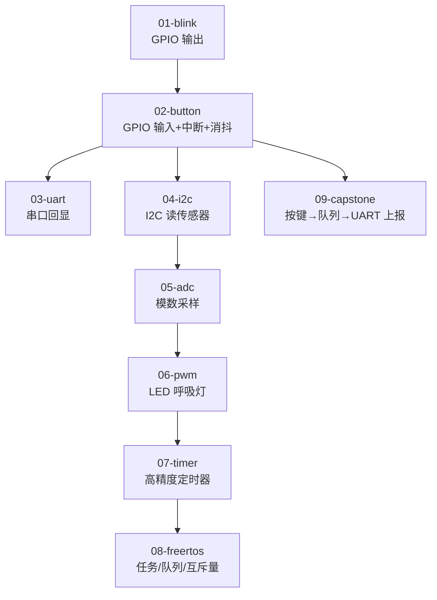

# ESP32 FreeRTOS 外设基础教程

一套**循序渐进**的 ESP32（ESP-IDF）外设与 FreeRTOS 示例集合：从点亮一颗 LED，到 GPIO 中断、UART、I2C、ADC、PWM、定时器，再到多任务调度与综合项目。每个示例都是**独立可编译的 ESP-IDF 工程**，代码即文档，适合作为嵌入式入门与面试作品。

## 学习路径



## 目录

| 示例 | 主题 | 关键 API |
|---|---|---|
| `01-blink` | GPIO 输出翻转 | `gpio_set_direction` / `gpio_set_level` |
| `02-button` | GPIO 输入 + 下降沿中断 + 队列 + 软件消抖 | `gpio_isr_handler_add` / `xQueueSendFromISR` |
| `03-uart` | UART0 回显 | `uart_driver_install` / `uart_read_bytes` |
| `04-i2c` | I2C 主机读寄存器（以 QMI8658 为例） | `i2c_master_bus_add_device` / `i2c_master_transmit_receive` |
| `05-adc` | 单次 ADC 采样 | `adc_oneshot_new_unit` / `adc_oneshot_read` |
| `06-pwm` | LEDC 呼吸灯 | `ledc_timer_config` / `ledc_set_duty` |
| `07-timer` | esp_timer 周期回调 | `esp_timer_create` / `esp_timer_start_periodic` |
| `08-freertos` | 生产者/消费者（队列 + 互斥量） | `xTaskCreate` / `xQueueCreate` / `xSemaphoreCreateMutex` |
| `09-capstone` | 综合：按键 → 队列 → 任务 → UART 上报 | 整合 02 + 03 |

## 环境与构建

```bash
# 1. 安装 ESP-IDF 并激活环境（Linux/macOS）
. $HOME/esp/esp-idf/export.sh

# 2. 进入任一示例目录编译、烧录、监视
cd 08-freertos
idf.py set-target esp32s3      # 或 esp32 / esp32c3
idf.py build flash monitor
```

> 引脚为示例默认值（LED=GPIO2、按键=GPIO0、I2C=SDA21/SCL22），实际板子请按原理图修改宏定义。

## 设计要点（面试可讲）

1. **中断上下文安全**：GPIO 中断里只做最小动作（向队列发令牌），真正的处理放到任务里，避免 ISR 中执行耗时逻辑——这是 RTOS 的通用范式。
2. **消抖**：硬件中断 + 任务内 50ms 延时再判电平，简单可靠；进阶可用定时器队列 `timer_create` 做更精准消抖。
3. **队列解耦**：`08-freertos` 用队列在任务间传递数据、用互斥量保护共享资源（打印），体现了多任务系统的核心同步手段。
4. **外设驱动分层**：ESP-IDF v5 的 I2C 使用 `i2c_master_bus` / `i2c_master_dev` 新 API，比旧 `i2c_param_config` 更清晰，示例已对齐新接口。

## 扩展方向

- `02-button` 改用 `esp_timer` 做硬件级消抖
- `04-i2c` 接入真实 IMU（如 QMI8658）做姿态解算
- `08-freertos` 引入 `EventGroup` / `Task Notification` 替代队列
- `09-capstone` 增加 LCD 显示与上位机协议

## License

[MIT](LICENSE)
